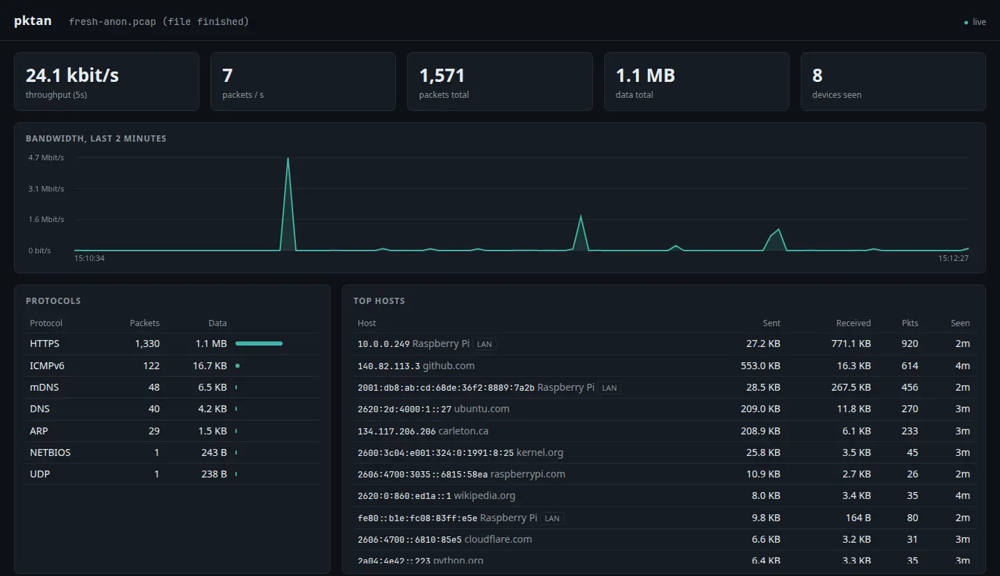
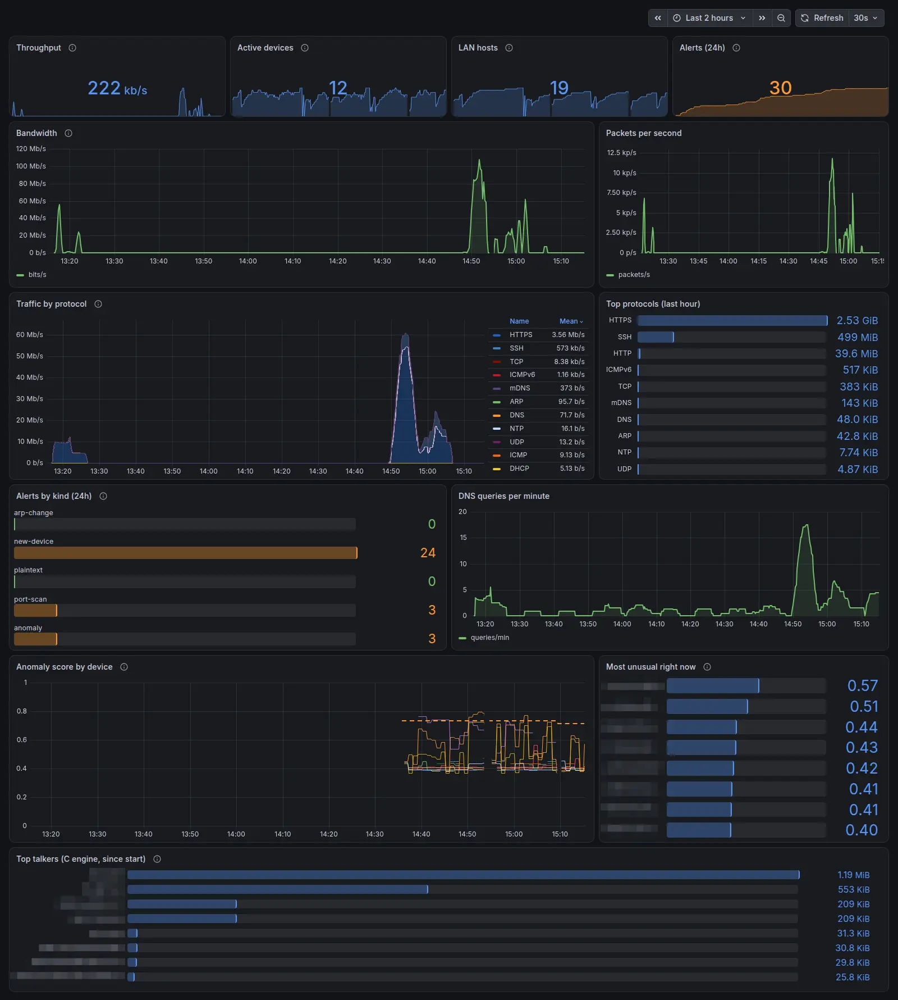
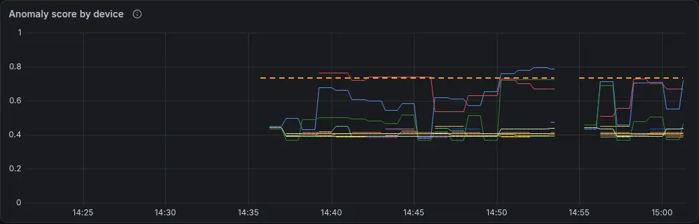
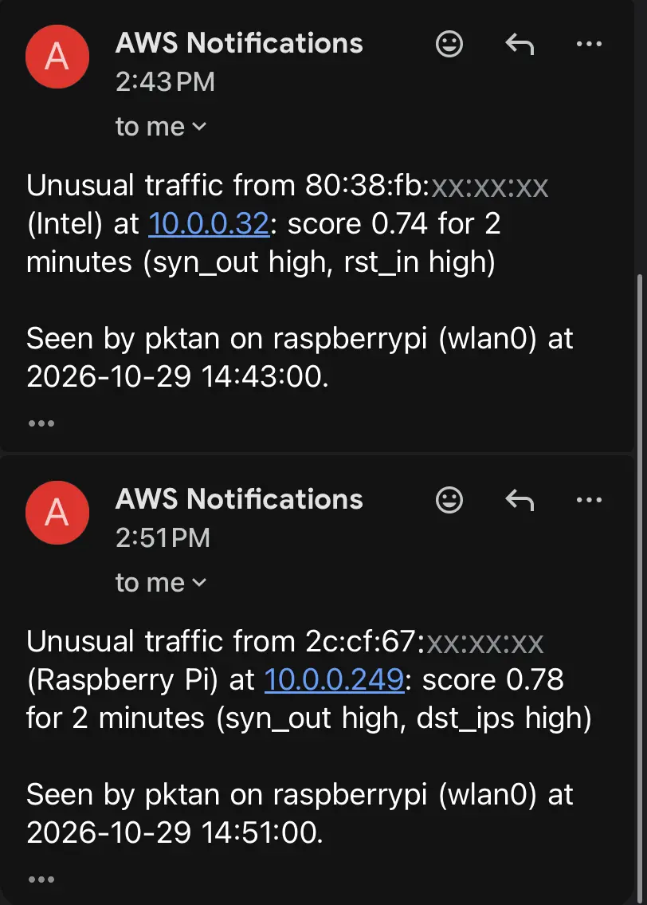
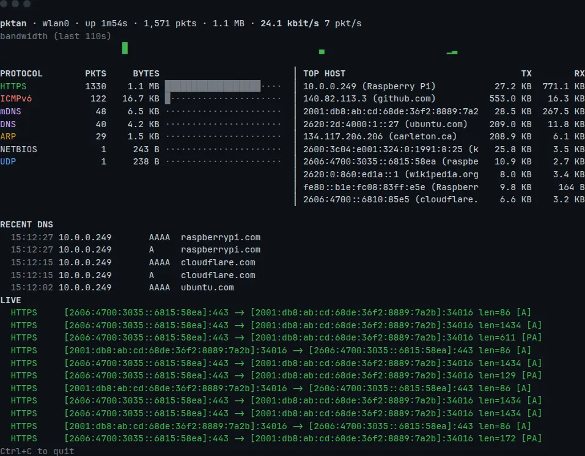

# pktan: Raspberry Pi network packet analyzer

A packet analyzer that lives on my Raspberry Pi 5. A C engine reads traffic straight off the network card, every header is decoded by hand, and an Isolation Forest learns what normal looks like for each device. Prometheus and Grafana keep the history, and AWS emails me when something looks wrong.

**Full write-up, with the story behind each decision: [zaidahmad.dev/projects/rpi-packet-analyzer](https://zaidahmad.dev/projects/rpi-packet-analyzer)**



*The browser dashboard after two minutes on my home Wi-Fi. Addresses in all screenshots are scrubbed.*

I wanted to know what the devices in my house were saying to each other, and I wanted to understand it down to the byte instead of letting Wireshark do the interesting part.

## Results

| | |
|---|---|
| **3.8M packets/s** | parsed by the C engine on a Raspberry Pi 5 (109x the Python decoder) |
| **13 protocols** | decoded by hand, with no capture library and no third-party Python packages |
| **0 false alarms** | from the Isolation Forest on 91 held-out ordinary device-minutes, where fixed thresholds raised 1 |
| **60 tests** | hand-built packets, AWS's own signing test vectors, C/Python parity checks and an AddressSanitizer fuzz run |

Against three attacks from my laptop, recorded separately so none of them leaked into training:

| | fixed thresholds | Isolation Forest |
|---|---|---|
| Port scan, ~500 ports/min | caught | caught (0.77) |
| Slow scan, 9 ports/min for 3 min | **missed** | **caught** (0.75) |
| 150 MB upload over 2 min | caught | missed (0.73, threshold 0.734) |

The slow scan stays under every fixed limit, and the forest caught it every minute. It missed the bulk upload by a hair, and the byte limit caught that one, so pktan runs both. The model was trained on about two hours of traffic. That's enough to show the idea works, but not enough to know what nights, weekends or updates look like, so retrain it after a few days of logging.



## What it does

- **Captures live traffic** with a raw `AF_PACKET` socket on Ethernet, Wi-Fi, VLAN-tagged and tunnel interfaces (Tailscale/WireGuard), or all of them at once.
- **Decodes** Ethernet, 802.1Q, ARP, IPv4, IPv6 (with extension headers), TCP, UDP, ICMP/ICMPv6, DNS/mDNS/LLMNR, DHCP (including client hostnames), TLS SNI, HTTP Host, and QUIC detection.
- **Names things.** A list of IP addresses turns into github.com, carleton.ca and "the Windows PC in the other room", using DNS answers, TLS SNI, mDNS announcements, DHCP hostnames and the vendor prefix of each MAC address.
- **Shows it** one line per packet like tcpdump, as a live dashboard in the terminal, or as the same dashboard in any browser on the network.
- **Alerts** on new devices (remembered across restarts), an IP address that moves to a different MAC (ARP spoofing or an IP conflict), port scans, unencrypted Telnet/FTP, and unusual traffic from the anomaly model. Alerts go to email or SMS through AWS SNS.
- **Keeps history** in Prometheus, graphed in a provisioned Grafana dashboard, and archives full captures to S3.
- **Filters** in a tcpdump-like syntax (`tcp port 443`, `dns or arp`, `host 10.0.0.5 and not port 22`, `net 192.168.1.0/24`), and reads and writes `.pcap` files that Wireshark opens.
- **Runs for weeks.** Every table is bounded, capture files have a size cap, and the systemd service runs as a throwaway user with only the capture permission.

## How it's built, and what went wrong

Each of these has a longer *Why / The struggle / The fix* section on the [project page](https://zaidahmad.dev/projects/rpi-packet-analyzer).

**Python with no dependencies.** The Pi runs Ubuntu, which won't let you `pip install` into the system Python, and I wanted `git clone` and run. The standard library has raw sockets, `struct`, an HTTP server and threads, which was everything the core needed. The C engine only needs a compiler, and scikit-learn is only needed to *train* the model, not to run it.

**Decoding by hand instead of Scapy.** I built this to learn what's in a packet. Each decoder reads one header and hands the rest to the next. Real traffic is messier than the specs: DNS names can point at themselves forever, and frames arrive cut off. So every decoder treats bad input as normal, and a test chops every sample packet every 7 bytes. The bug that surprised me most: mDNS announcements put their address records in the "additional" section, which my parser skipped, so no device names showed up until it read every section.

**Raw sockets instead of libpcap.** `AF_PACKET` is built into Linux and tells you each frame's interface and link type. That mattered: Tailscale's tunnel frames have no Ethernet header, and the Pi's k3s adds a virtual interface per container, so "the first interface" was never a sensible default.

**A C engine for the fast path.** `csrc/pktcap.c` reads a TPACKET_V3 ring (8 MiB shared with the kernel, no system call per packet), parses L2 to L4 itself, keeps per-source counts in a fixed-size open-addressing hash table, and picks the top talkers with a min-heap. It sends Python a 76-byte summary per packet, plus the raw bytes only when Python must look deeper. My first benchmark was humbling: C parsed 210x faster, but the whole pipeline only got 1.2x faster. A profiler showed Python re-parsing the same IP strings for every packet. Caching that made both engines roughly twice as fast, and the honest end-to-end gain is 1.5x.

**A browser dashboard over Server-Sent Events.** The data only goes one way, once a second, so SSE over plain HTTP was enough and the browser reconnects by itself. The first time I ran it over SSH, 24 of the first 25 packets were SSH: the analyzer was watching its own output. The web mode now filters out its own port.

**Prometheus and Grafana on k3s.** The browser dashboard only knows the last two minutes. The Pi already ran k3s, so Prometheus and Grafana run there, provisioned from files. My first dashboard lied in small ways: one alert read as "1.01", one alert was drawn as a dozen bars, and normal traffic showed red. Every query was checked against the live Prometheus before shipping.

**Alerts through AWS, signed by hand.** I wrote AWS Signature Version 4 myself rather than pull in an SDK, checked it against AWS's published examples, and the first real call worked. The first real alert emails were wrong, though: a Hikvision device seen an hour earlier, and the Pi's own Ethernet port, reported as "new devices" because pktan forgot the network on every restart. It now remembers known devices.

**An Isolation Forest instead of more thresholds.** Every minute, each device's traffic becomes ten numbers (packets and bytes each way, packet size, hosts and ports reached, SYNs, resets, DNS lookups, ARP requests). scikit-learn trains the forest. The trees are exported to JSON and scored in about 35 lines of pure Python, so the always-on service never loads numpy; a test checks the scores match scikit-learn's to 1e-9. The most convincing result wasn't planned: the model flagged the Pi itself. My S3 archiver had started capturing its own uploads and re-uploading them, one 50 MB file every three seconds. pktan now leaves its own AWS connections out of what it saves and scores.





*The real alert emails: the slow scan from my laptop, and the Pi flagging itself. The device half of each MAC is hidden.*

**What I learned.** Where an analyzer sits matters more than how it's written: on Wi-Fi the Pi only sees its own traffic plus broadcasts, and with Wi-Fi and Ethernet on the same subnet, traffic to one interface's address can arrive on the other. HTTPS hides what you send but not who you talk to. "C is 210 times faster" was true and nearly useless next to the number for the whole pipeline. And a wrong alarm is worse than no alarm: the logic mattered more than the delivery, and only real email in a real inbox showed me that.

## Quick start (on the Pi)

```bash
git clone https://github.com/zaidahmad16/rpi-packet-analyzer.git
cd rpi-packet-analyzer

python3 -m pktan list                          # interfaces (* = default)
sudo python3 -m pktan sniff -f "not port 22"   # one line per packet
sudo python3 -m pktan top                      # live terminal dashboard
sudo python3 -m pktan web                      # browser dashboard on :8080
```

Then open **http://raspberrypi.local:8080** from any device on the network.

Requirements: Linux and Python 3.10+. Nothing to `pip install`. pktan builds the C engine on first use if `cc` and `make` are there, and otherwise falls back to the pure-Python engine.

```
$ sudo python3 -m pktan sniff -f "dns or https"
12:42:54.945 DNS       [2001:db8:ab:cd:68de:36f2:8889:7a2b]:43941 -> [2607:f798:18:10:0:640:7125:5204]:53 len=101 query A github.com
12:42:54.968 DNS       [2607:f798:18:10:0:640:7125:5204]:53 -> [2001:db8:ab:cd:68de:36f2:8889:7a2b]:43941 len=117 response A github.com -> 140.82.114.3
12:42:54.998 HTTPS     10.0.0.249:56012 -> 140.82.112.3:443 len=1490 [A] SNI=github.com
12:43:27.929 HTTPS     10.0.0.249:42860 -> 134.117.206.206:443 len=1434 [A] SNI=carleton.ca
```



### Without sudo
Live capture needs `CAP_NET_RAW`. You can grant it to the Python binary once:
```bash
sudo setcap cap_net_raw,cap_net_admin+eip "$(readlink -f "$(which python3)")"
```
Analysing a saved file never needs privileges:
```bash
python3 -m pktan top --read capture.pcap
```

### Run on boot
```bash
./install-pi.sh pi@raspberrypi.local --service
```
This copies the code to `/opt/pktan`, builds the C engine, and installs `systemd/pktan.service`. The service runs as its own throwaway system user (`DynamicUser`) with only the raw-capture capabilities and a 200 MB memory cap. Extra options (interface, AWS) go in `/etc/pktan.env`; see the AWS section below.

## Commands

| Command | What it does |
|---|---|
| `pktan list` | List interfaces and show which one is the default |
| `pktan sniff [-c N] [--stats]` | Print packets as they arrive; `--stats` adds a summary at the end |
| `pktan top [--realtime]` | Full-screen terminal dashboard |
| `pktan web [--port 8080] [--bind ADDR]` | Web dashboard (JSON at `/api/stats`, live stream at `/events`, Prometheus at `/metrics`) |
| `pktan aws-check [--sns-topic ARN] [--s3-bucket NAME]` | Send a test alert and upload a test file to prove the AWS setup works |
| `pktan bench FILE.pcap [--repeat N]` | Packets per second for the Python engine, the C engine, and C parsing alone, plus peak memory |
| `pktan features FILE.pcap... --out F.csv` | Turn saved captures into per-device feature rows |
| `pktan train [--state-dir DIR]` | Fit the Isolation Forest on logged features (needs `python3-sklearn`) |
| `pktan evaluate [--attack NAME CSV MAC]` | Fixed thresholds vs the Isolation Forest on held-out data and attack captures |

Shared options: `--engine auto|c|python` (default `auto`: C when `csrc/pktcap` is built), `-i IFACE` (or `any`), `-r FILE.pcap`, `-f FILTER`, `-w FILE.pcap --max-mb 50`, `--no-promisc`, `--state-dir DIR`, and the AWS options `--sns-topic ARN`, `--alerts-per-hour N`, `--s3-bucket NAME`, `--s3-prefix P`.

`web` hides its own dashboard traffic automatically (`--include-self` turns that off).

## The C engine

```bash
make -C csrc            # builds csrc/pktcap (make -C csrc asan for a sanitizer build)
python3 -m pktan bench capture.pcap --repeat 100
```

`pktcap` reads packets from a TPACKET_V3 ring that the kernel fills in 1 MiB blocks. It parses Ethernet, 802.1Q, IPv4, IPv6, TCP and UDP itself and sends Python a fixed 76-byte summary per packet. The raw bytes only go along when Python has to look deeper: DNS, DHCP, ARP, TLS client hellos, HTTP requests, ICMP, or anything malformed. With `--write`, every raw frame is sent for saving, but only those packets are decoded in Python. Per-source counters live in an 8,192-slot open-addressing table; when it's three-quarters full the least recently seen half is dropped, so a scan of a /16 can't grow it. Every second a size-K min-heap picks the top talkers, and they appear in `/metrics` as `pktan_source_bytes`.

On a Raspberry Pi 5 with a real home-network capture replayed 100 times (133,900 packets):

| | packets/s | |
|---|---|---|
| Python engine (decode + stats) | 34,668 | 1.0x |
| C engine end to end (pktcap + Python stats) | 52,157 | 1.5x |
| C parsing alone (`pktcap -n`) | 3,780,082 | 109x |

End to end the gain is 1.5x, because Python's per-packet bookkeeping (stats, flows, names) is now the slow part. Either way it's far beyond what a home network sends. The live service uses about 9 MB for `pktcap` and 39 MB for Python.

## Anomaly detection

Every minute pktan turns each active device's traffic into ten numbers. They're log-scaled and appended to `$STATE_DIRECTORY/features.csv`, which is capped at 20 MB.

```bash
sudo apt install python3-sklearn        # only training needs it
cd /opt/pktan && sudo python3 -m pktan train --state-dir /var/lib/pktan
sudo systemctl restart pktan            # the service loads iforest.json on start
```

`train` fits scikit-learn's `IsolationForest` on the earliest 70% of rows, in time order. The alert threshold is the higher of 0.5 and the score that only 0.5% of training rows exceed. The trees are exported to `iforest.json` and the service scores each device-minute in pure Python. A device has to score above the threshold for two minutes in a row before it raises an `anomaly` alert, which goes through SNS like the others and names the features furthest from normal. Scores appear in `/metrics` as `pktan_anomaly_score` and on the Grafana dashboard.

`pktan evaluate` compares this with a typical fixed-threshold detector (static limits on packets, bytes, destinations, ports, SYNs, resets and DNS queries per minute) on the held-out rows and on recorded attacks.

## Prometheus and Grafana

`pktan web` serves Prometheus metrics at `/metrics`: packet and byte counters (total and per protocol), DNS queries, alerts by kind, anomaly scores, the C engine's top talkers, kernel drops, and gauges for devices, LAN hosts and conversations. Label sets are capped so an odd mix can't blow up Prometheus.

`deploy/k8s/` runs Prometheus and Grafana on the Pi's k3s, next to pktan:

```bash
sudo ./deploy/k8s/install.sh          # prints the Grafana admin password once
```

- Grafana at **http://raspberrypi.local:30300** opens on the provisioned *pktan network overview* dashboard. Anyone on the LAN can view it; editing needs the admin login.
- Prometheus keeps 30 days of data, capped at 1.5 GB.
- Prometheus uses host networking and scrapes `127.0.0.1:8080`, so pktan has to be running as the service (see *Run on boot*).
- `sudo ./deploy/k8s/install.sh --remove` deletes all of it.

## AWS: alerts by SNS, captures to S3

pktan can push alerts to an **SNS topic**, so they reach your phone or email. With `--write`, it can also upload each full capture file to **S3** and then delete it locally, so the SD card never fills. Requests are signed with a hand-written AWS Signature Version 4, so there's no SDK to install. pktan never saves or scores its own AWS connections, so archiving can't feed on itself.

Setup in the AWS console:

1. **SNS:** create a Standard topic called `pktan-alerts`, add a subscription (email or SMS), and confirm it.
2. **S3:** create a bucket (private, all public access blocked). Add a lifecycle rule that expires `pktan/` objects after 30 days.
3. **IAM:** create a user with no console access, attach an inline policy from [`deploy/aws/iam-policy.json`](deploy/aws/iam-policy.json) (fill in region, account ID and bucket), and create an access key for it. The policy only allows publishing to that one topic and uploading under `pktan/` in that one bucket.
4. On the Pi, put the settings in `/etc/pktan.env` and lock it down (`sudo chmod 600 /etc/pktan.env`):
   ```
   AWS_ACCESS_KEY_ID=AKIA...
   AWS_SECRET_ACCESS_KEY=...
   AWS_REGION=us-east-2
   PKTAN_ARGS="--sns-topic arn:aws:sns:us-east-2:123456789012:pktan-alerts --alerts-per-hour 5 -w /var/lib/pktan/capture.pcap --max-mb 50 --s3-bucket YOUR-BUCKET"
   ```
5. Check it end to end, then restart the service:
   ```bash
   sudo bash -c 'set -a; . /etc/pktan.env; cd /opt/pktan && python3 -m pktan aws-check \
     --sns-topic "arn:aws:sns:...:pktan-alerts" --s3-bucket YOUR-BUCKET'
   sudo systemctl restart pktan
   ```

Alerts are capped per hour (`--alerts-per-hour`, default 20); the next message says how many were held back. SNS and S3 calls run on background threads, so a slow or missing connection never stalls capture. Failed uploads are retried at the next rotation, with at most 3 files kept waiting. SNS email stays within the always-free 1,000 notifications a month; S3 storage for a few GB of captures costs cents.

## What the Pi can actually see

A packet analyzer only sees traffic that physically reaches its network card:

- **On Wi-Fi or a normal switch port**, the Pi sees its own traffic plus broadcast and multicast: ARP, DHCP, mDNS, SSDP, IPv6 neighbor discovery. That's enough to discover devices and names, but you won't see other devices' web browsing.
- **To see everything**, put the Pi in the path. You can:
  - plug it into a switch's mirror/SPAN port;
  - make it the network's router or access point (e.g. `hostapd` on `wlan0` with `eth0` as uplink, then capture on `wlan0`);
  - bridge `eth0` to a USB Ethernet adapter, sit it inline between the router and a device, and capture on `br0`.
- **With Wi-Fi and Ethernet on the same subnet**, Linux answers for either address on either interface, so traffic to the Wi-Fi address can arrive on Ethernet. Capture with `-i any`, or set `net.ipv4.conf.all.arp_ignore=1`.

When you watch it over SSH, add `-f "not port 22"`, or the analyzer ends up mostly watching its own output.

## Layout

```
pktan/
  decode.py    protocol decoders -> Packet
  capture.py   AF_PACKET + pcap sources, interface discovery, filter compiler
  engine.py    capture thread: packets -> filter -> stats / pcap writer
  cengine.py   runs csrc/pktcap and turns its records into Packets
  stats.py     rolling counters, device/name tracking, alerts
  features.py  per-device feature windows and the capped CSV log
  iforest.py   Isolation Forest training (sklearn), export, pure-Python scoring, evaluation
  pcap.py      pcap reader/writer (size-capped)
  tui.py       sniff + top terminal views
  web.py       HTTP server, JSON API, Server-Sent Events, /metrics
  metrics.py   Prometheus text exposition
  aws.py       SigV4 signing, SNS alerts, S3 capture archiving
  static/index.html  dashboard (vanilla JS, no CDN, works offline)
csrc/          pktcap.c, the C capture engine, and its Makefile
deploy/k8s/    Prometheus + Grafana manifests and install script for k3s
deploy/grafana/  the provisioned dashboard
deploy/aws/    least-privilege IAM policy
docs/images/   screenshots (addresses scrubbed)
tests/         python3 -m unittest discover -s tests
```

## Limitations

- Linux only (raw sockets use `AF_PACKET`). On other systems, `--read` still works.
- Reads classic `.pcap`, not `.pcapng`. Convert with `editcap -F pcap in.pcapng out.pcap`.
- No TCP stream reassembly: SNI and HTTP Host come from the first segment, which covers almost all real traffic.
- The anomaly model is only as good as the "normal" it was trained on. A model trained on a few hours hasn't seen nights, weekends or updates; retrain after a few days of logging.
- The filter is applied in Python, after capture. With the Python engine, expect drops at several hundred Mbit/s on a Pi. It's built for home and lab networks.
